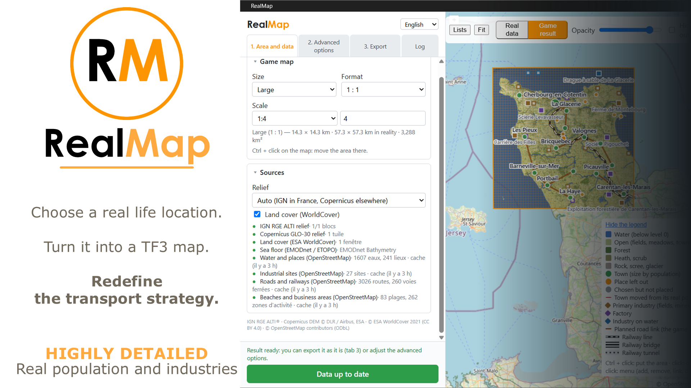
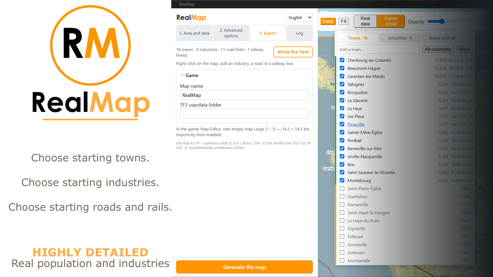
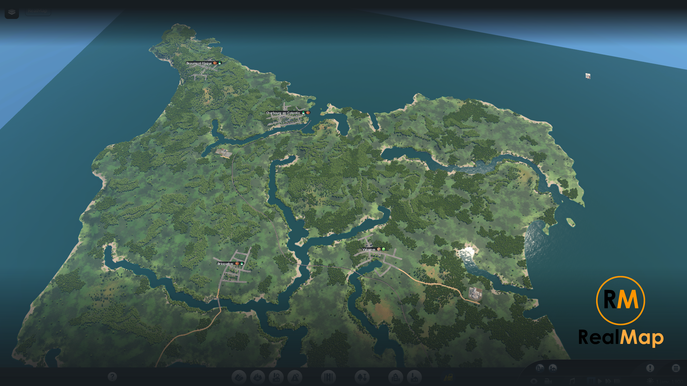

  

<h1 align="center">RealMap</h1>

  <b>Choisis un lieu réel. Transforme-le en carte Transport Fever 3. Redéfinis la stratégie de transport.</b>

   English ·  Français ·  Deutsch ·  Italiano ·  Español ·  简体中文 
  💻 Windows · Linux · macOS

  <a href="https://github.com/Spit8/RealMap/releases/latest"><b>⬇ Télécharger l'application</b></a> ·
  <a href="README.md"> English version</a>

RealMap construit une carte personnalisée de Transport Fever 3 à partir d'une zone réelle : relief,
mer, rivières et lacs, biomes, villes à leur taille réelle, industries nommées, liaisons routières et
voie ferrée, le tout depuis des données ouvertes. **L'application RealMap** prépare la carte ; **le mod
RealMap** la construit tout seul dans l'éditeur de cartes du jeu.

## Langues

L'application et le mod en jeu sont tous deux disponibles dans les six langues ci-dessus.

- L'application prend la langue du système au premier lancement ; elle se change avec le sélecteur en
  haut du panneau. Le mod suit la langue du jeu (anglais si la langue du jeu n'est pas dans la liste).
- L'anglais et le français sont écrits à la main. L'allemand, l'italien, l'espagnol et le chinois sont
  des traductions automatiques faites avec le contexte de chaque phrase et le vocabulaire du jeu,
  vérifiées seulement par retraduction : les corrections sont les bienvenues.
- Seuls les **détails techniques** du journal (affichés avec *Détails*) restent en français.

## Fonctions

- **N'importe quel lieu du monde** : tailles et formats de carte du jeu, échelle de 1:1 (taille réelle)
  à 1:8, zone choisie sur une carte.
- **Relief et eau réels** : altitudes IGN RGE ALTI en France et Copernicus GLO-30 ailleurs, fonds marins
  EMODnet (Europe) ou ETOPO ; rivières continues et navigables aux berges douces ; lacs ; marais
  transformés en lacs peu profonds ; profondeur des rivières, des marais et des côtes réglable.
- **Biomes** d'après ESA WorldCover : forêts, champs, broussailles, roche ; pas d'arbres sur les plages.
- **Villes à leur taille réelle** (population OpenStreetMap), avec leurs parts de quartiers commerciaux
  et industriels tirées des vraies zones d'activité, et des besoins de départ choisis loin des usines
  qui les produisent, comme le fait le jeu.
- **Industries** tirées des vrais sites industriels et de l'occupation du sol, avec leur vrai nom, en
  nombre fixé par la densité et l'économie du jeu.
- **Liaisons routières** entre les villes : choisies automatiquement (chaque ville reliée à 1 ou 2
  autres le long des vraies routes), puis modifiables à volonté. Le jeu trace les routes lui-même.
- **Une voie ferrée** qui suit la vraie ligne principale, adaptée au relief du jeu (le long des berges
  plutôt qu'en traversant les rivières), avec courbes, pentes, ponts et tunnels calculés par l'appli.
- **Tes choix** : clic droit sur la carte pour ajouter ou retirer villes, industries, liaisons
  routières et voies ferrées ; toutes les listes dans un panneau sur la carte.
- **Un clic dans le jeu** : l'application écrit les fichiers, le mod construit dans l'ordre relief,
  biomes, voie ferrée, villes, industries et routes, et l'application affiche chaque étape.

## Installation

Il faut **l'application et le mod**.

### 1. Le mod
**Mod Hub (recommandé) :** dans le menu principal du jeu, ouvre le **Mod Hub**, cherche **RealMap** et
abonne-toi.

**À la main :** télécharge `realmap-mod-<version>.zip` sur la page
[Releases](https://github.com/Spit8/RealMap/releases/latest), décompresse-le et copie le dossier
`importcity` dans le dossier `mods` du jeu :
- Steam : `<Steam>\userdata\<SteamID>\3493540\local\mods\` (sous Windows, `<Steam>` est par défaut
  `C:\Program Files (x86)\Steam`, et `<SteamID>` est le numéro de ton compte Steam) ;
- GOG et Epic Games Store : `%APPDATA%\Transport Fever 3\mods\`.

### 2. L'application
Télécharge le fichier de ton système sur la page [Releases](https://github.com/Spit8/RealMap/releases/latest) :

| Système | Fichier |
|---|---|
| Windows | `RealMap_<version>_x64-setup.exe` (ou le `.msi`) |
| Windows, sans installation | `RealMap_<version>_x64-portable.zip` : décompresse-le où tu veux et lance `RealMap.exe` |
| Linux | `.AppImage` (portable) ou `.deb` |
| macOS (Apple Silicon et Intel) | `.dmg` |

- **Windows** a besoin de Microsoft WebView2, déjà présent sur Windows 11 et la plupart des PC sous
  Windows 10. Les installeurs l'ajoutent s'il manque ; le zip portable contient
  `MicrosoftEdgeWebview2Setup.exe` : lance-le seulement si l'application ne démarre pas.
- **Les installeurs ne sont pas encore signés**, le premier lancement demande donc une confirmation :
  - Windows SmartScreen : *Informations complémentaires* → *Exécuter quand même* ;
  - macOS Gatekeeper : clic droit sur l'application → *Ouvrir*.
- Au premier lancement, l'application trouve le dossier de données du jeu (Steam :
  `<Steam>\userdata\<SteamID>\3493540\local` ; GOG / Epic : `%APPDATA%\Transport Fever 3`). Sinon,
  indique-le dans l'onglet **3. Export**.

### Mises à jour
- **L'application** cherche les nouvelles versions au démarrage (onglet **3. Export** › *Mises à jour* ;
  désactivable). Les versions installées (et l'AppImage) se mettent à jour d'elles-mêmes avec
  *Installer et redémarrer* ; le zip portable et le `.deb` affichent un lien vers la nouvelle version.
- **Le mod** se met à jour par le Mod Hub (ou en remplaçant le dossier `importcity`).

## Prise en main

1. **Onglet 1 — Zone et données** : choisis la **taille** et le **format** de la carte du jeu, l'**échelle**,
   et déplace la zone avec **Ctrl + clic** sur la carte. Clique sur **Récupérer les données** : relief,
   occupation du sol, fonds marins et données OpenStreetMap sont téléchargés, puis le résultat du jeu est
   calculé et affiché sur la carte.
2. **Vérifie le résultat** avec la bascule **Données réelles / Résultat jeu** et le panneau **Listes**.
   Clic droit sur la carte pour ajouter ou retirer une ville, une industrie, une liaison routière ou une
   voie ferrée.
3. **Onglet 2 — Options avancées** (facultatif) : relief, profondeurs et berges, villes, industries,
   routes, voie ferrée. Le résultat se recalcule après chaque réglage.
4. **Dans le jeu** : ouvre l'**éditeur de cartes**, crée une **nouvelle carte vide** de la taille et du
   format indiqués dans l'onglet 3, et active le mod **RealMap**.
5. **Onglet 3 — Export** : nomme la carte et clique sur **Générer la carte**. Le mod construit tout seul
   (ne touche pas au jeu pendant ce temps) ; l'application affiche chaque étape et le rapport du mod.
6. **Enregistre** la carte depuis le menu de l'éditeur. La fenêtre du mod s'ouvre aussi avec le bouton
   RealMap de la barre du bas du jeu.

## Limites connues

- L'application est développée et testée sous **Windows** ; les versions Linux et macOS sont produites
  par le même procédé automatique mais n'ont pas encore été essayées (retours bienvenus).
- **Internet** est nécessaire pour récupérer les données. Le premier téléchargement d'une zone peut
  prendre quelques minutes : les serveurs OpenStreetMap (Overpass) sont partagés et parfois chargés.
  Les changements suivants réutilisent le cache.
- La carte se construit dans l'**éditeur de cartes**, sur une **nouvelle carte vide de même taille et
  même format** que dans l'application. Le mod ne fait rien dans une partie en cours.
- Les plus grandes tailles et formats (1:4, 1:5, Énorme…) n'apparaissent qu'avec les **fonctions de
  carte expérimentales** du jeu (`experimentalMapFeatures = true` dans le `settings.lua` du jeu) ; les très
  grandes cartes sont longues à calculer et à construire.
- Le nombre de **villes** est plafonné par la limite du jeu pour la taille de carte ; les villes trop
  proches les unes des autres ou de l'eau sont déplacées ou écartées (les listes disent pourquoi).
- **Routes** : la carte montre seulement les liaisons prévues ; le jeu trace les routes à sa façon et y
  raccorde les industries.
- **Voie ferrée** : la ligne principale réelle, plus celles que tu ajoutes, sans gares ni trains. Les
  endroits très pentus ou très bâtis peuvent laisser de courtes coupures (indiquées dans le rapport du mod).
- La **précision du relief** dépend de la source : jusqu'à 1 m (IGN, France seulement) ou 30 m
  (Copernicus) ; les fonds marins sont grossiers hors d'Europe.
- Les données OpenStreetMap ne sont complètes que si la carte l'est dans la zone (populations, sites
  industriels, voies ferrées).
- Les installeurs **ne sont pas encore signés** (voir *Installation*).

## Données et licences

- Relief : IGN RGE ALTI® (Licence Ouverte Etalab), Copernicus DEM GLO-30 © DLR / Airbus, ESA.
- Fonds marins : EMODnet Bathymetry, NOAA ETOPO.
- Occupation du sol : © ESA WorldCover project 2021 (CC BY 4.0).
- Eau, lieux, sites industriels, routes et voies ferrées : © contributeurs OpenStreetMap (ODbL), via
  l'API Overpass.

## Contribuer

- Bugs et idées : [GitHub Issues](https://github.com/Spit8/RealMap/issues).
- Compiler, le mod et les publications : [docs/DEVELOPMENT.md](docs/DEVELOPMENT.md) (en anglais).
- Traductions : [tools/i18n/README.md](tools/i18n/README.md).

## Licence

[GPL-3.0](LICENSE) © 2026 Wilfried Lambert. Transport Fever est une marque d'Urban Games ; RealMap est
un projet amateur indépendant, ni affilié à Urban Games ni approuvé par lui.
