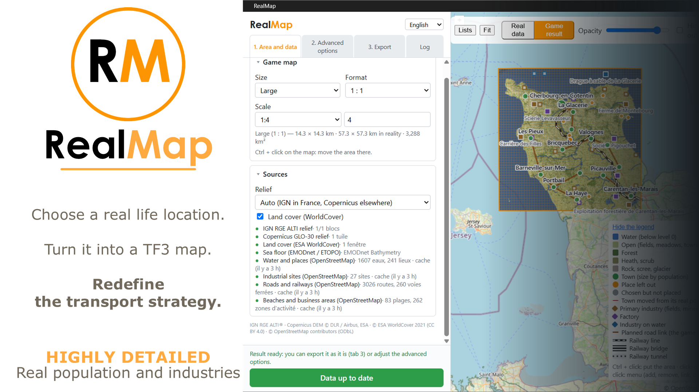
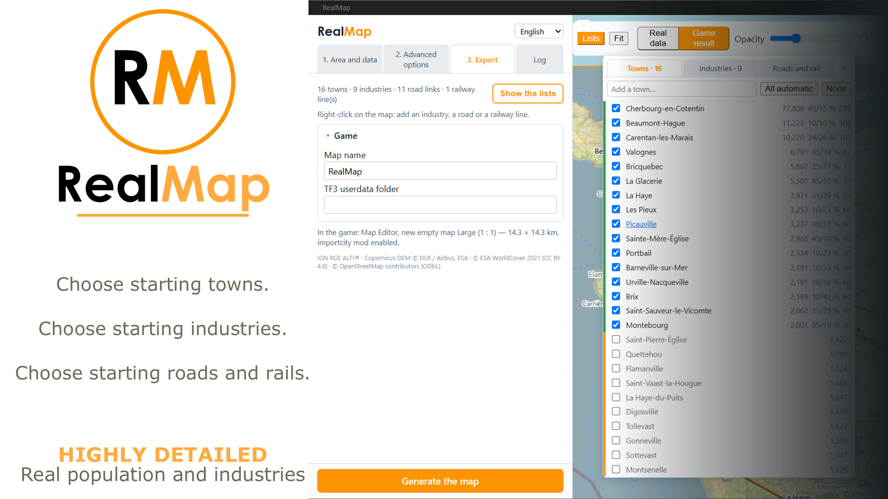
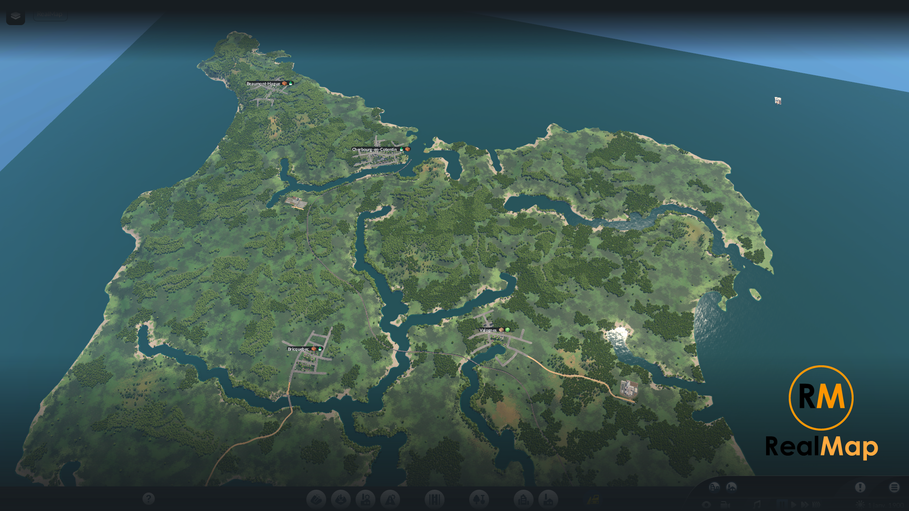

  

<h1 align="center">RealMap</h1>

  <b>Choose a real place. Turn it into a Transport Fever 3 map. Redefine the transport strategy.</b>

   English ·  Français ·  Deutsch ·  Italiano ·  Español ·  简体中文 
  💻 Windows · Linux · macOS

  <a href="https://github.com/Spit8/RealMap/releases/latest"><b>⬇ Download the app</b></a> ·
  <a href="README.fr.md"> Version française</a>

RealMap builds a custom Transport Fever 3 map of a real-world area: relief, sea, rivers and lakes,
biomes, towns at their real size, named industries, road links and a railway, all from open data.
The **RealMap desktop app** prepares the map; the **RealMap mod** builds it by itself in the game's
Map Editor.

## Features

- **Any place in the world**: the game's map sizes and formats, a scale from 1:1 (real size) to 1:8,
  the area picked on a map.
- **Real relief and water**: elevation from IGN RGE ALTI in France and Copernicus GLO-30 elsewhere,
  sea floor from EMODnet (Europe) or ETOPO; continuous, navigable rivers with gentle banks; lakes;
  marshes turned into shallow lakes; adjustable river, marsh and coast depths.
- **Biomes** from ESA WorldCover: forests, fields, scrub, rock; no trees on the beaches.
- **Towns at their real size** (population from OpenStreetMap), with commercial and industrial
  shares from the real business areas, and starting goods drawn far from the factories that make
  them, as the game does.
- **Industries** from the real industrial sites and the land cover, named after the real ones, in
  the number the game's density and economy ask for.
- **Road links** between towns: chosen automatically (each town linked to 1 or 2 others along the
  real roads), then yours to change. The game lays the roads with its own routing.
- **A railway** following the real main line, adjusted to the game's relief (along the banks rather
  than across the rivers), with its curves, gradients, bridges and tunnels designed in the app.
- **Your choices**: right-click the map to add or remove towns, industries, road links and railway
  lines; lists of everything in a panel over the map.
- **One click in the game**: the app writes the files, the mod builds relief, biomes, railway, towns,
  industries and roads in order, and the app shows each step.

## Installation

You need **both** the app and the mod.

### 1. The mod
**Mod Hub (recommended):** in the game's main menu, open the **Mod Hub**, search for **RealMap** and
subscribe.

**By hand:** download `realmap-mod-<version>.zip` from the
[Releases](https://github.com/Spit8/RealMap/releases/latest) page, unzip it and copy the
`importcity` folder into the game's `mods` folder:
- Steam: `<Steam>\userdata\<SteamID>\3493540\local\mods\` (on Windows `<Steam>` is by default
  `C:\Program Files (x86)\Steam`, and `<SteamID>` is the number of your Steam account);
- GOG and Epic Games Store: `%APPDATA%\Transport Fever 3\mods\`.

### 2. The app
Download the file for your system from the [Releases](https://github.com/Spit8/RealMap/releases/latest) page:

| System | File |
|---|---|
| Windows | `RealMap_<version>_x64-setup.exe` (or the `.msi`) |
| Windows, no install | `RealMap_<version>_x64-portable.zip`: unzip anywhere and run `RealMap.exe` |
| Linux | `.AppImage` (portable) or `.deb` |
| macOS (Apple Silicon and Intel) | `.dmg` |

- **Windows** needs Microsoft WebView2, already present on Windows 11 and most Windows 10 PCs. The
  installers add it if it is missing; the portable zip includes `MicrosoftEdgeWebview2Setup.exe`: run
  it only if the app does not start.
- **The installers are not signed yet**, so the first launch asks for a confirmation:
  - Windows SmartScreen: *More info* → *Run anyway*;
  - macOS Gatekeeper: right-click the app → *Open*.
- On first launch the app finds the game's data folder (Steam:
  `<Steam>\userdata\<SteamID>\3493540\local`; GOG / Epic: `%APPDATA%\Transport Fever 3`). If it does
  not, enter it in tab **3. Export**.

### Updates
- **The app** checks for new versions at startup (tab **3. Export** › *Updates*; can be turned off).
  Installed versions (and the AppImage) update themselves with *Install and restart*; the portable
  zip and the `.deb` show a link to the new version.
- **The mod** is updated by the Mod Hub (or by replacing the `importcity` folder).

## Getting started

1. **Tab 1 — Area and data**: choose the game map **size** and **format**, the **scale**, and move the
   area with **Ctrl + click** on the map. Click **Get the data**: relief, land cover, sea floor and the
   OpenStreetMap data are downloaded, then the game result is computed and shown on the map.
2. **Check the result** with the **Real data / Game result** switch and the **Lists** panel. Right-click
   the map to add or remove a town, an industry, a road link or a railway line.
3. **Tab 2 — Advanced options** (optional): relief, water depths and banks, towns, industries, roads,
   railway. The result is recomputed after each change.
4. **In the game**: open the **Map Editor**, create a **new empty map** with the size and format shown
   in tab 3, and enable the **RealMap** mod.
5. **Tab 3 — Export**: name the map and click **Generate the map**. The mod builds everything by itself
   (do not touch the game meanwhile); the app shows each step and the mod's report.
6. **Save** the map from the Map Editor menu. You can also open the mod's window with the RealMap
   button in the game's bottom bar.

## Known limitations

- The app is developed and tested on **Windows**; the Linux and macOS builds are made by the same
  automatic process but have not been tried yet (feedback welcome).
- **Internet** is needed to fetch the data. The first download of an area can take a few minutes:
  the OpenStreetMap (Overpass) servers are shared and sometimes busy. Later changes reuse the cache.
- The map is built in the **Map Editor**, on a **new empty map of the same size and format** as in the
  app. The mod does nothing in a running game.
- Bigger sizes and formats (1:4, 1:5, Huge…) only appear with the game's **experimental map
  features** (`experimentalMapFeatures = true` in the game's `settings.lua`); very big maps are slow to
  compute and to build.
- **Towns** are capped by the game's limit for the map size; towns too close to each other or to the
  water are moved or left out (the lists say why).
- **Roads**: the map shows the planned links only; the game lays the roads with its own routing and
  links the industries to them.
- **Railway**: the main real line, plus the lines you add, without stations or trains. Very steep or
  built-up places can leave short gaps (listed in the mod's report).
- **Relief precision** depends on the source: up to 1 m (IGN, France only) or 30 m (Copernicus);
  the sea floor is coarse outside Europe.
- OpenStreetMap data is only as complete as the map is in that area (populations, industrial sites,
  railways).
- The installers are **not signed** yet (see *Installation*).

## Data and licenses

- Relief: IGN RGE ALTI® (Licence Ouverte Etalab), Copernicus DEM GLO-30 © DLR / Airbus, ESA.
- Sea floor: EMODnet Bathymetry, NOAA ETOPO.
- Land cover: © ESA WorldCover project 2021 (CC BY 4.0).
- Water, places, industrial sites, roads and railways: © OpenStreetMap contributors (ODbL), through the
  Overpass API.

## Contributing

- Bug reports and ideas: [GitHub Issues](https://github.com/Spit8/RealMap/issues).
- Building from source, the mod and releases: [docs/DEVELOPMENT.md](docs/DEVELOPMENT.md).
- Translations: [tools/i18n/README.md](tools/i18n/README.md).

## License

[GPL-3.0](LICENSE) © 2026 Wilfried Lambert. Transport Fever is a trademark of Urban Games; RealMap is
an independent fan project, neither affiliated with nor endorsed by Urban Games.
